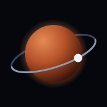
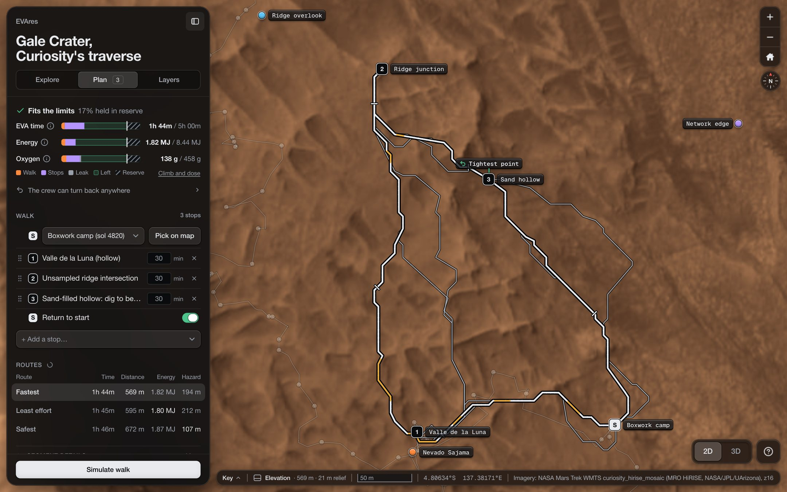
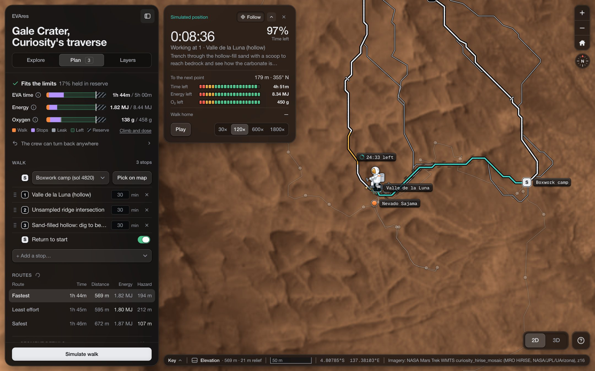
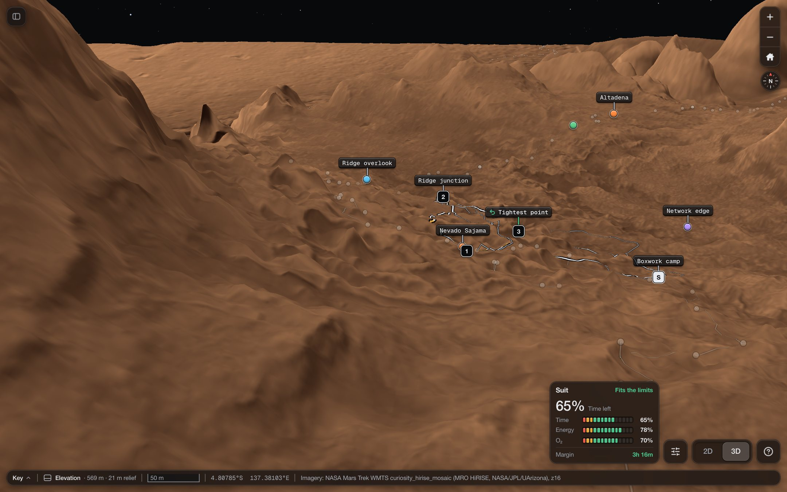
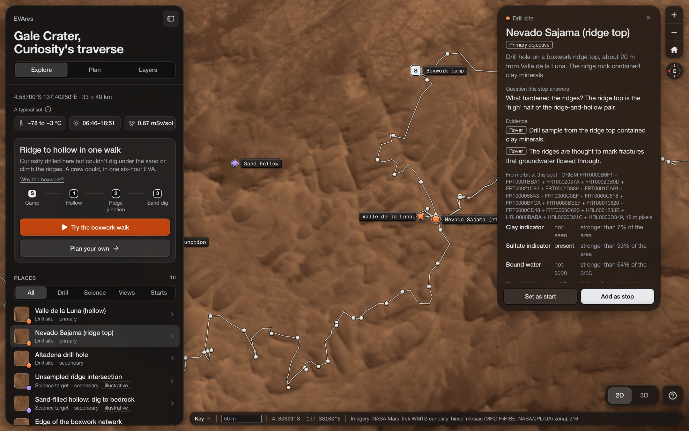
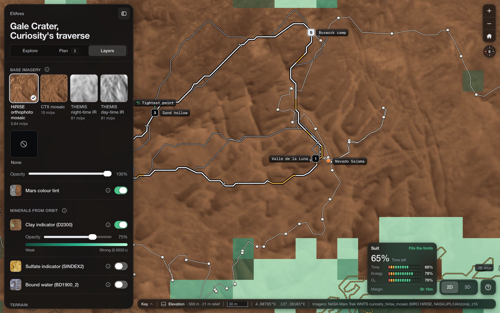

<p align="center">
  <a href="https://evares.wtarit.me"></a>
</p>

<h1 align="center">Plan your walk on Mars.</h1>

<p align="center">
  <a href="https://marsmap.wtarit.workers.dev"></a>
  <a href="https://www.spaceappschallenge.org/"></a>
  <a href="https://github.com/dekkinlarp/nasa-space-apps-2026/commits/main"></a>
  <a href="LICENSE"></a>
</p>

<p align="center">
  <a href="https://evares.wtarit.me">Try it</a> - <a href="docs/deployment.md">Deployment docs</a> - <a href="https://github.com/dekkinlarp/nasa-space-apps-2026/issues/new">Report a bug</a>
</p>

<h2 align="center">EVAres is an EVA planner for the Gale Crater boxwork, built on NASA and USGS data.</h2>

<p align="center">
        
</p>

> [!NOTE]
> This is our entry for NASA Space Apps Challenge 2026 (Vancouver), challenge "Interplanetary Survival Guide: Martian Map". It is a hackathon prototype, not flight software. See [Honest limits](#honest-limits).

<p align="center">
  
</p>

## Table of contents

* [Introduction](#introduction)
  * [Features](#features)
  * [Who is it for?](#who-is-it-for)
  * [What EVAres isn't](#what-evares-isnt)
  * [A look around](#a-look-around)
* [Golden case: ridge to hollow in one walk](#golden-case-ridge-to-hollow-in-one-walk)
* [Data sources](#data-sources)
  * [Where each walk-model number comes from](#where-each-walk-model-number-comes-from)
  * [Checks we ran on the data](#checks-we-ran-on-the-data)
* [Honest limits](#honest-limits)
* [Run it](#run-it)
* [How it works](#how-it-works)
  * [Map rendering](#map-rendering)
  * [Planning window](#planning-window)
  * [Code layout](#code-layout)
  * [Changing things](#changing-things)
* [Contribute](#contribute)
* [Team](#team)
* [AI use](#ai-use)
* [Thank you, open source and open data](#thank-you-open-source-and-open-data)
* [License](#license)

## Introduction

EVAres is a Google-Maps-style tool for planning an astronaut walk (EVA) on Mars, built entirely on NASA and USGS orbital and rover data. The map covers a 33 x 40 km region of Gale Crater: all of Curiosity's drive, from Bradbury Landing to the boxwork ridges it studied in 2025-26. Pick a start and science stops, and the planner answers the questions a crew has before stepping outside.

Try it: **https://evares.wtarit.me**

### Features

* **Which way do we walk?** Three routes (fastest, least effort, safest) with time, distance, slope, surface, energy, oxygen and radiation per segment.
* **Can we make it back?** A walk-limit ring shows how far the crew can go and still get home inside the suit's time, energy and oxygen budget, with a safety reserve held back. Each route gets a "turn back by" time (point of no return).
* **Where is the science?** Orbital mineral maps show where water-formed minerals (clay, hydrated sulfate, bound water) were seen from orbit, and every point of interest says what Curiosity did there, what it couldn't do, and what a crew could.
* **Four modes:**
  * **Explore:** Curiosity's traverse, waypoints (click one for its sol, rover tilt and the Navcam photos taken there), its drill sites and hand-picked science targets. Each card shows elevation, slope, surface and the orbital mineral readings at that spot. The tab opens with typical conditions at Curiosity (air temperature range, daylight hours, radiation dose) from its REMS and RAD instruments.
  * **Plan:** choose a start (a rover stop or any point), add stops from a card or by clicking the map, drag to reorder, set work time per stop, loop back to start. Compare the three routes, read the elevation and slope profile, and watch the time, energy and oxygen budget bars and the turn-back time.
  * **Go:** plays the planned walk as a simulated astronaut with time, energy and oxygen left, bearing and the walk home.
  * **Layers:** base imagery (HiRISE photo, CTX, THEMIS day/night infrared), slope, elevation, hillshade, estimated surface and its uncertainty, mineral indicators, walk cost from the start, walk-limit rings. 2D or 3D with adjustable vertical exaggeration.

### Who is it for?

Mission planners, students and space enthusiasts who want to see what a walk on Mars costs in time, energy, oxygen and radiation before it happens, and who want to know what a crew could do at a site that a rover could not.

### What EVAres isn't

* **Not navigation.** Mars has no GPS. "Go" plays a simulated walk.
* **Not a validated surface map.** The surface estimate comes from orbit and is not checked against rover observations.
* **Not a mineral abundance map.** The CRISM layers are indicators, not abundances.
* **Not live.** The app never calls NASA at run time. Everything is prepared ahead by the data pipeline.

### A look around

Screenshots of the live deployment on 15 November 2026, with the built-in boxwork walk loaded.

**Plan** (the picture at the top of this page). The verdict comes first: whether the walk fits, then time, energy and oxygen against their limits with the safety reserve hatched. Under it are the stops in walking order and the three routes to compare. On the map the chosen route turns amber where it crosses hazard slope and carries a bar every 100 m.



**Go.** A simulated astronaut walks the route. The panel shows the clock, what the crew is doing at the stop, and what is left of time, energy and oxygen. The label over the walker counts down the work left there.



**3D.** The same plan on the terrain. Labels stand on posts above their places, and the suit panel stands in for the Plan tab while the side panel is hidden.



**Explore.** Each place says what question a stop there answers and what the answer rests on: evidence is tagged Rover or Orbit, and the card lists the orbital mineral readings at that spot.



**Layers.** Clay seen from orbit (CRISM D2300) over the HiRISE photo. Each block is one 18 m CRISM pixel, drawn as it is rather than smoothed.

## Golden case: ridge to hollow in one walk

Curiosity spent most of a year at the boxwork, a network of low ridges and sand-filled hollows that likely formed when groundwater flowed through cracks in the rock. It drilled three holes about 6 cm deep (clay in a ridge, carbonate in a hollow), slipped in the sand-filled hollows, and left the main questions open. A crew can do what the rover couldn't: cross ridge to hollow, sample ridge walls, dig under the sand to bedrock and trace the edge of the network, in one six-hour walk. "Try the boxwork walk" in the app loads one such plan: camp, hollow, ridge junction, sand dig.

## Data sources

Everything is downloaded and prepared ahead of time by the data pipeline; the app never calls NASA live.

| Data | Source | Used for |
|---|---|---|
| Elevation, 1 m, averaged to 2 m | USGS Astrogeology "Mars MSL Gale Merged DEM 1m v3" (HiRISE/CTX/HRSC tied to MOLA), https://astrogeology.usgs.gov/search/map/mars_msl_gale_merged_dem_1m | Slope, routing, 3D terrain, hillshade, elevation profile |
| Slope | Derived from the elevation (Horn method, 3x3 cells) | Routing cost, impassable ground, slope layer |
| Orbital photo, 0.64 m/px | NASA Mars Trek WMTS `curiosity_hirise_mosaic` (MRO HiRISE, NASA/JPL/UArizona), https://trek.nasa.gov/mars/ | Base map, surface estimate. The photo is grayscale; the Mars colour tint is cosmetic and can be switched off |
| Context and thermal imagery | Mars Trek `Gale_CTX_BlockAdj_dd` (MRO CTX, 10 m/px), THEMIS day/night IR mosaics (Mars Odyssey, ~100 m/px) | Alternative base layers (thermal is context only) |
| Mineral indicators, 18-36 m/px | 19 MRO CRISM targeted observations (2007-2011), summary-parameter products from the NASA PDS Geosciences Node: clay (D2300), hydrated sulfate (SINDEX2), bound water (BD1900_2). Indicators, not abundances | Mineral layers, readings on each card |
| Surface conditions | **Estimate** from elevation roughness and HiRISE brightness/texture (sand, bedrock, rubble, firm soil); not ground-truthed | Routing cost, surface layer |
| Curiosity track and waypoints | NASA/JPL MSL localized traverse, https://mars.nasa.gov/mmgis-maps/MSL/Layers/json/MSL_waypoints.json | Track layer, start spots, drill-site positions, slope check |
| Rover photos | NASA Mars raw images feed (Curiosity Navcam), https://mars.nasa.gov/rss/api/?feed=raw_images&category=msl&feedtype=json | Ground-level previews |
| Weather | Curiosity REMS feed, https://mars.nasa.gov/rss/api/?feed=weather&category=msl&feedtype=json (last record sol 4995, not live) | Conditions bar, shown as typical values |
| Radiation | 0.67 mSv/day, Curiosity RAD (Hassler et al. 2014), https://www.swri.org/press-release/swri-scientists-publish-first-radiation-measurements-surface-mars | Dose per walk |
| Points of interest | Hand-written in `config/pois.json` from JPL and NASA Curiosity blog posts; drill sites use rover waypoint positions; science targets are marked illustrative | Pins and cards |

How each file is downloaded and processed: [scripts/README.md](scripts/README.md).

### Where each walk-model number comes from

Defaults live in `config/walk-params.json`; equations, URLs and caveats are in [packages/core/README.md](packages/core/README.md).

| Parameter | Default | Basis |
|---|---|---|
| Walking speed, flat firm ground | 1.0 m/s | Apollo walk-back planning |
| Maximum walkable slope | 20° | Artemis suit capability |
| Caution slope | 15° | Assumption |
| EVA time limit | 6 h | BASALT analog flight rule |
| Safety reserve | 1/6 | BASALT: 5 h plan plus 30 min margin |
| Time per stop | 30 min | BASALT |
| Body / suit mass | 82 kg / 104 kg | ICES-2026-127 |
| Energy budget | 10,130 kJ | 352 W suit sizing rate over 8 h |
| Energy model | Pandolf load-carriage equation with downhill correction | NASA JSC (Kim et al. 2024); scaling to Mars gravity is our assumption |
| Surface speed and terrain factors | see `config/surface-classes.json` | Assumptions |
| Oxygen carried | 0.55 kg | **Placeholder**: Shuttle/ISS suit primary charge; no Mars suit tank is defined |
| Oxygen use | 0.071 g per kJ + 5 g/h leakage | Physiology (20.1 kJ per litre of O2); leakage is an assumption |
| Radiation | 0.67 mSv/day | Curiosity RAD |

### Checks we ran on the data

`pnpm --filter @marsmap/scripts run verify` reads the data the way the app does and writes `data/<id>/preview/verify-report.json`.

* **Elevation vs the rover:** at all 1389 of Curiosity's waypoints, the map's elevation matches the waypoint's own with a median difference of 2.7 cm (95% within 14 cm). The waypoint elevations are probably sampled from this same DEM, so this checks georeferencing and tile encoding, not the DEM's absolute accuracy.
* **Slope vs the rover:** at the waypoints our slope and the rover's recorded tilt agree at the median (7.2° vs 7.7°, median difference 1.7°). Over the region the median slope is 4°; 10% is steeper than 21°.
* **Mineral layers vs the photo:** as delivered, the CRISM scenes sit 70 to 250 m off the HiRISE photo. The pipeline shifts each scene to best match the photo (the main boxwork scene goes from r = 0.69 to 0.83); every scene lands at about the same offset. Expect one to two 18 m pixels of residual error.

## Honest limits

* Mars has no GPS. "Go" plays a simulated walk.
* The surface map is an estimate from orbit, not validated against rover observations.
* The boxwork ridges are sharp in the photo but barely resolved in the elevation data, so ridge and hollow targets are hand-placed, not detected.
* Sand and dust hide minerals from orbit: CRISM shows no clay signal at Nevado Sajama, where Curiosity's drill found clay. The CRISM map is a mosaic of 19 scenes taken years apart; seams are real, so compare values within one scene. 21% of the region has no CRISM coverage.
* The oxygen limit is a simple model with a placeholder tank size. Change it with the "Oxygen carried" slider.
* A walk is planned on an 8 km square around the start and stops (see [Planning window](#planning-window)). Stops more than about 8 km apart cannot be planned in one walk, and on the open plains, where a crew could walk farther, the walk-limit ring is cut at the square's edge (the map key says so).
* Walk limits take about 10 s to compute in the boxwork and about 35 s on the open plains.
* Stops are visited in the order given; the planner does not reorder them.
* Routes move between 8 neighbouring 2 m cells, so paths can run up to about 8% longer than ideal.
* About 11.6% of the region (its corners, outside the DEM) has no elevation; the map leaves it blank and routes avoid it.
* Memory heavy: the app holds about 350 MB of full-resolution rasters in the page plus a copy in each of two routing workers. Not tried on an iPad.

## Run it

```bash
pnpm install
pnpm data      # one-time: downloads ~4.3 GB from NASA/USGS, about 1 h in all; keeps ~550 MB in data/<id> plus ~8 GB of cache (gitignored)
pnpm dev       # one Vite dev server on http://localhost:5173 (app, API Worker and map data)
pnpm test      # routing core and web unit tests
pnpm typecheck
```

`http://localhost:5173/?area=fixture` runs on synthetic test data (`pnpm --filter @marsmap/web fixture`).

Deploying to Cloudflare and publishing map data releases: [docs/deployment.md](docs/deployment.md).

## How it works

### Map rendering

The map is MapLibre GL. MapLibre assumes Earth, so Mars longitude and latitude are drawn as if they were Earth's (about 0.35% scale distortion at this latitude); all distances and times come from the routing core, not the map.

* **Base imagery** is full resolution across the whole region. The pipeline ships each imagery set as a pyramid of JPEG pictures (level 0 at full resolution in pieces of at most 2048 px, each level up 4x coarser). A custom `marsimg://` protocol cuts 256 px map tiles out of the level that matches the zoom and applies the Mars tint on the fly (`apps/web/src/map/imageryTiles.ts`).
* **Data layers** (elevation, slope, surface, uncertainty) are drawn twice: a 16 m overview of the whole region, and on top of it full 2 m resolution inside the planning window. Outside the window slopes are 16 m means and read gentler than they are. Mineral layers are on the 16 m grid everywhere, drawn pixel by pixel. Walk cost and walk-limit rings exist only inside the window.
* **3D terrain** is generated in the browser: a `marsdem://` protocol encodes Terrarium height tiles from the same overview and window grids (`apps/web/src/map/dem.ts`). Heights are scaled by R_earth / R_mars so that vertical x1 is true Mars proportion; the slider goes to x10. Hillshade uses the same tiles.
* **3D performance** (`apps/web/src/map/terrainPerf.ts`): only terrain inside a square around where the camera looks is drawn (the "Draw" setting: 2, 4, 8 or 16 km, default 8), and picking what lies under the mouse ray-marches the in-memory elevation grid instead of reading pixels back from the GPU. `cameraClearance.ts` keeps the camera from dipping into hillsides.

### Planning window

The region is too big to load whole at 2 m (330 million cells), so the data is stored as 1 km tiles (512 x 512 cells). The app loads the 16 m overview of everything, plus full-resolution tiles for an 8 km square around the walk (the *planning window*, drawn as a dashed square). Routes and walk limits are computed on that square in two Web Workers (one for routes, one for the slower walk-limit flood); the window moves when the start or a stop comes within 2 km of its edge.

### Code layout

| Path | What |
|---|---|
| `config/` | Everything tunable: `area.json` (bounds, tile size), `walk-params.json`, `surface-classes.json`, `pois.json` |
| `scripts/` | Data pipeline. Downloads and prepares everything. [Details and sources](scripts/README.md) |
| `packages/core/` | Routing, walk model, walk-limit rings, tile decoding and the planning window. Pure TypeScript. [Equations and sources](packages/core/README.md) |
| `apps/web/` | React + MapLibre GL app (2D and 3D). Its `vite.config.ts` also runs the Worker and serves `data/` |
| `apps/server/` | Small Hono API as a Cloudflare Worker (`/api/areas`, `/api/config`) |
| `data/` | Generated, not in git |

### Changing things

* **Different region:** edit `config/area.json` (width and height multiples of `tileSize`), run `pnpm data`. The current region is about the largest box inside both the DEM and the HiRISE mosaic.
* **Better surface map:** `scripts/src/import-layer.ts` resamples a grid or image onto the shared grid and registers it; no code change needed. See [scripts/README.md](scripts/README.md).
* **Walk model:** edit `config/walk-params.json` or `config/surface-classes.json`.
* **New cost factor** (shade, radiation shelter, no-go zones): add one factor function in `packages/core/src/costModel.ts`; the search and UI do not change.

## Contribute

Issues and pull requests are welcome.

* Found a bug or a wrong number? [Open an issue](https://github.com/dekkinlarp/nasa-space-apps-2026/issues/new) with the walk you planned and what you expected.
* Want to improve the walk model? Start with [packages/core/README.md](packages/core/README.md) and `config/walk-params.json`.
* Want to improve the data? Start with [scripts/README.md](scripts/README.md). If your change alters what ends up in `data/`, it needs a new data release, so read [docs/deployment.md](docs/deployment.md) and [AGENTS.md](AGENTS.md) first.
* Working on the UI? Use the components in `apps/web/src/components/ui` and the design tokens in `apps/web/src/index.css`.

## Team

Built by our UBC team at the NASA Space Apps Challenge 2026, Vancouver Local Event.

* [cyanghxst](https://github.com/cyanghxst)
* [All contributors](https://github.com/dekkinlarp/nasa-space-apps-2026/graphs/contributors)

## AI use

AI coding assistants were used while building this project, for code and documentation. All AI-assisted output was reviewed by the team. The screenshots above are captures of the running app, not AI-generated images.

## Thank you, open source and open data

EVAres stands on the work of others.

* **Data:** NASA (Mars Trek, PDS Geosciences Node, MSL raw images and weather feeds, MMGIS), JPL, MRO HiRISE, CTX, CRISM (JHU/APL), Mars Odyssey THEMIS, USGS Astrogeology, and the Curiosity REMS and RAD teams. Full list with URLs in [Data sources](#data-sources).
* **Libraries:** [MapLibre GL](https://maplibre.org/), [React](https://react.dev/), [Vite](https://vite.dev/), [Tailwind CSS](https://tailwindcss.com/), [shadcn/ui](https://ui.shadcn.com/) on [Base UI](https://base-ui.com/), [Hono](https://hono.dev/), [Cloudflare Workers](https://workers.cloudflare.com/), [pnpm](https://pnpm.io/), TypeScript. Exact versions are in each `package.json`.
* **Research:** Hassler et al. 2014 (Curiosity RAD), Kim et al. 2024 (NASA JSC, energy model), BASALT analog flight rules, ICES-2026-127.

This project is not affiliated with or endorsed by NASA.

## License

The code in this repository is released under the [MIT License](LICENSE). In short: you may use, copy, modify, merge, publish, distribute, sublicense and sell it, in source or built form, provided the copyright notice and the licence text are kept with it. It comes "as is", with no warranty of any kind, and the authors are not liable for anything that follows from using it.

The licence covers the code and the project's own text. It does not cover the map data, which come from NASA and USGS and keep the terms of their sources (see [Data sources](#data-sources)).
